# Novafos/Easy-Energy integration

[](https://github.com/custom-components/hacs)

The `novafos` component is a Home Assistant custom component for monitoring your water metering data from Novafos (via KMD Easy-Energy).

---
# Installation
---

### Manual Installation
  1. Copy novafos folder into your custom_components folder in your hass configuration directory.
  2. Restart Home Assistant
  3. Add and configure the Novafos integration.
  4. Restart Home Assistant.

### Installation with HACS (Home Assistant Community Store)
  1. Ensure that [HACS](https://hacs.xyz/) is installed.
  2. Search for and install the Novafos integration.
  3. Add and configure the Novafos integration.
  4. Restart Home Assistant.

---
## Configuration
---

Fully configurable through config flow.
  1. Head to configuration --> integration
  2. Add new and search for Novafos
  3. Enter your name for the sensors, default is "Novafos". Different instances can use the same name.
  4. Leave external hourly consumption statistics enabled to use min/max/mean and consumption trends in Statistics Graph cards.
  5. Enter a valid access token to retrieve your addresses.
  6. Select an address. If the account has only one address, it is selected automatically.
  7. Select a water or heating meter at that address. A single available meter is selected automatically.

Repeat **Add integration** for each meter you want to monitor. For two addresses with one water meter and one heating
meter each, add four instances. Reuse the same access token for addresses linked to the same account.

Use the sensor and statistic IDs assigned to your meter when configuring dashboards. For example:
* Sensor entity: `sensor.novafos_12345678_44556677_water_statistics`
* External statistic: `novafos:12345678_44556677_water_hourly_consumption`

To update an access token for one instance, open its **Configure** dialog. To update all loaded instances, call
`novafos.update_token`. If your instances use separate logins, supply `config_entry_id` to target the intended instance.

Use **Configure** to enable or disable external statistics. The main hourly `sensor.*` history is always recorded.

---
# Notice on integration status and ways to login
---

The integration works only off valid Bearer tokens extracted from a 'proper' login on the Novafos website.
If you want to make it really easy, you may want to check out the Chrome extension I wrote for that very purpose.
Check this repository: https://github.com/kpoppel/homeassistant-novafos-chrome-addon

Unfortunately Novafos and KMD "Easy-Energy" does not care anything about secure machine-usable access to their customer's
data, except through their own services, like the website, and the proprietary Watts app.

The extension used to be able to login using OICD (which is pretty safe, right), or email/password combination, but through
the introduction of reCAPTCHA, this is no longer possible to automate.  This is the reason the extension relies on
a human login, after which the rest can be automated.

Want to help the digital age for _your_ data? If you want to ensure free and opensource access to your data in your own home,
please help KMD realise there is a need for this.  Sure the claim can be that you have free access to your data through the
portal, and even through the Watts app only available on mobile devices.  These are all closed source solutions however,
and eliminates homegrown solutions like Home Assistant to thrive.

If you use the integration please write to KMD Easy-energy, or call their contact number to ask for this.  You can even give
an example of where this actually works by referring to eloverblik.dk where a personal access token can be generated and used
by your own tools.

Until KMD Easy-energy agrees to provide open access to your own data, the integration needs a little help now and then.

There is a thread on the forum as well: https://community.home-assistant.io/t/hidden-recaptcha-on-novafos-smart-water-meter/559633

# Login methods

**NOTE:** The extension currently only supports tokens retrieved from login using email and password. MitID login is not tested and reported not working at this time. (Thanks to bimmer1977 for reporting).

## Method 1: Using Chrome add-on (medium advanced, has some requirements, recommended).

Install the Chrome extension from this Github repository: https://github.com/kpoppel/homeassistant-novafos-chrome-addon/releases.
README file in that place for the details. The extension automates scraping the token and sending it to Home Assistant.
Note you have to setup Home Assistant to be accessible through HTTPS.

## Method 2: Login on website and manually find and copy token to Home Assistant

This method is 100% manual, but will ensure you get data into Home Assistant regardless.  Why would you do this then?
Well I cannot say, but maybe doing this once per week or month is a good way to keep tabs on consumption or dripping
faucets along with all your other precious data.

This is how the manual method works:

1. Use F12 inyour browser to turn on developer tools
1. Login using your browser as you would do without Home Assistant on the website.
1. Investigate the network traffic and find the line including "token".  Just search for this word.
1. Switch to the Response tab. You see this:
   ```
   {
     "access_token": "<token>",
     "token_type": "Bearer",
     "expires_in": 3599,
     "scope": "openid profile pluginapi_int",
     "id_token": "<id token>"
   }
   ```
1. Go to the integration page in settings and select "Configure" on the Novafos integration.
1. Copy the `access_token` part into the Access Token field (this is a very long string of random characters)
1. The integration will sense the token changed and trigger only within the next 45 minutes to update the sensors.
1. Data is fetched as usual.
1. Repeat as often as you like - you are using a token generated from a human interaction, satisfying the login process.

---
# State and attributes

Data is delayed in the data warehouse.  Data validity will range from 24h to 5 days ago from today's midnight.
This means the sensor data represents historical data and that the sensors presented by the integration have no current state (unknown).
The integration imports this historical data into Home Assistant's long-term statistics. Use a Statistics graph, Statistic card,
Energy dashboard or ApexCharts card to show it. An Entities card will only show the unknown current state.

This means we have a slightly different visualisation flow compared to other sensors.

The integration creates the following sensors for water/heating (here water used an an example).  "novafos" is configurable, this is the default value:
* sensor.novafos_water_statistics
  * Statistics sensor with hourly resolution. Stores a cumulative `sum`. Use `change` to see consumption per hour, day, week or month.
  * This is the sensor you want to use for the energy dashboard.
* `novafos:water_hourly_consumption` (optional external statistic; `novafos:heating_hourly_consumption` for heating)
  * Hourly based statistics. Use `change` in the built-in Statistics graph to show consumption trends day-to-day, week-to-week, month-to-month or year-to-year.
  * This statistic has min/max/mean/change data calculated.
  * Use `min` to detect leaks. It should always be 0.0 if you are not spending water all the time.
  * Use `max` to find days of extraordinary water consumption.
  * Use `mean` to see average consumption per reported hour within the selected period. The mean is dependent on the hours with data points.
  * Use `change` to see the trend of consumption between selected periods. A rising trend is probably not a good sign.

Water statistics use cubic meters (m3), heating statistics kilowatt-hours (kWh). Only `sum` is stored, since Home Assistant does not
like `TOTAL` type sensors (statistics-only) to have `min`, `max` or `mean`. The `novafix:..._hourly_consumption` statistic stores
arithmetic min/mean/max and change without changing the Energy dashboard's sensor history.
The main sensor also exposes a `year_total` attribute when yearly data is available.

Replace dashboard references to `sensor.novafos_water_statistics_{day|week|month|year}` with the main hourly sensor
or external statistic for your meter. Select `change` and the desired day, week, month or year period to show consumption.
Remove unused grouped sensor entities through **Settings > Devices & services > Entities**. Their recorded history
is not deleted automatically.

Under consideration is adding attributes for some sort of high/low warning so that an indication for high water use or never having zero flow could be flagged.  You can add a helper which flags if the `min` is ever rising above 0.0.

# Visualisation of the sensors using built-in cards

Below some examples of how data can be visualised.  Only water is shown but the same should apply for heating data.

- Using the `sensor.novafos_water_statistics` sensor, you can show values of hourly consumption over intervals of this/last year/month/week/day
- Using `novafos:water_hourly_consumption`, you can show min/mean/max hourly consumption within a day, week, month or year.

Not all combinations will make sense. So try it out. The built-in cards are `Statistic` and `Statistic Graph`. An `Entity` card will _not_ work since there is no current state ever.

# Examples: The main sensor - sensor.novafos_water_statistics

The current state of this sensor is always 'unknown'. Use `change` on its long-term statistics to display consumption.
As the base data is hourly, the Statistics graph can aggregate it by day, week or month.

## Statistics cards (built-in)

Using the `sensor.novafos_water_statistics` with statistic type `change` and the `Statistic` card you can easily get data for periods out as a number.

Add a `Statistic` card configure the sensor and set the priod you like to get data for yesterday (not today), or other periods. You will see a card like this:

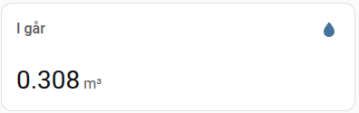

## Statistics graphs (built-in)

Repeating the exercise using the `Statistics Graph` card it is also simple to display graph data over a period.  Some examples using the `sensor.novafos_water_statistics`.

### Monthly data

- Card: Statistics graph
  - Period: Month
  - Stat type: Change
  - Chart type: Bar

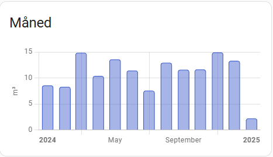

### Weekly data

- Card: Statistics graph
  - Period: Week
  - Stat type: Change
  - Chart type: Bar

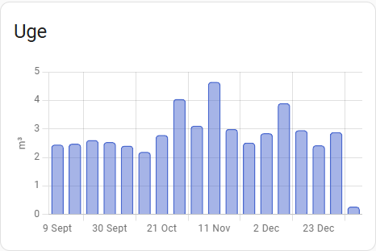

### Daily data

- Card: Statistics graph
  - Period: Day
  - Stat type: Change
  - Chart type: Bar

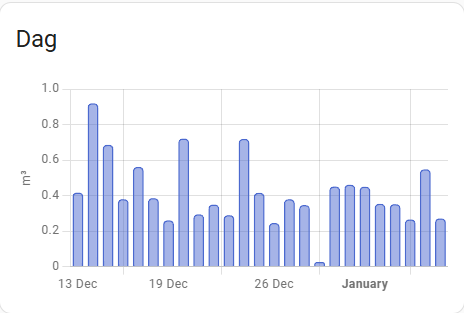

### Hourly data

- Card: Statistics graph
  - Period: Hour
  - Stat type: Change
  - Chart type: Bar

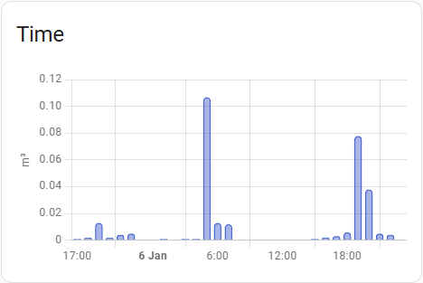

For the hourly data you can furthermore get graphs showing the sum, state and change in consumption across the periods.

- Card: Statistics graph
  - Period: Day
  - Stat type: Sum, State, Change
  - Chart type: Line

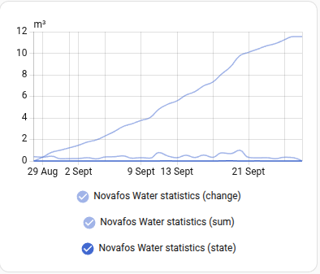

## Max, min, mean graphs using Apexchart

Since Home Assistant does not allow `TOTAL` type sensors to have mean values stored as statistics, we can calculate this
from the horly statistics values using Apexchart instead. The visualisation looks almost like the former data, and takes
a little more effort to setup.  For you: install Apexchart and copy the configurations below.

Use `sensor.novafos_water_statistics` with statistic type `change` to show the consumption within the selected period.

### Daily max/min/mean consumption using hour grouping

This configuration illustrates daily min/max/mean values across a month using hour-grouping.  The minimum is (hopefully) always 0.0 m3
unless there is a leak in the water system or we were filling up that swimming pool again that summer.

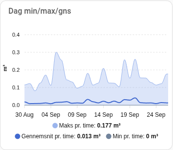

```
type: custom:apexcharts-card
graph_span: 28d
span:
  start: day
  offset: -28d
header:
  show: true
  title: Dag min/max/gns
series:
  - entity: sensor.novafos_water_statistics
    name: Maks pr. time
    type: area
    color: "#9bb5ed"
    opacity: 0.35
    stroke_width: 1
    float_precision: 3
    statistics:
      type: state
      period: hour
      align: start
    group_by:
      func: max
      duration: 1d
      fill: "null"

  - entity: sensor.novafos_water_statistics
    name: Gennemsnit pr. time
    type: line
    color: "#4169cf"
    stroke_width: 2
    float_precision: 3
    statistics:
      type: state
      period: hour
      align: start
    group_by:
      func: avg
      duration: 1d
      fill: "null"

  - entity: sensor.novafos_water_statistics
    name: Min pr. time
    type: line
    color: "#71839b"
    stroke_width: 1
    float_precision: 3
    statistics:
      type: state
      period: hour
      align: start
    group_by:
      func: min
      duration: 1d
      fill: "null"

apex_config:
  chart:
    height: 250
  yaxis:
    min: 0
    title:
      text: m³
```

The same graph can be displayed using the `Statistics Graph` card and using the `novafos:water_hourly_consumption` statistic with `max/min/mean` selected.

### Daily max/min/mean consumption

This configuration illustrates daily min/max/mean values across a month using a 2-day grouping.  It may not be very useful, but if you want to see grouped data across a period comparing adjacent days or other periods, this is the way.

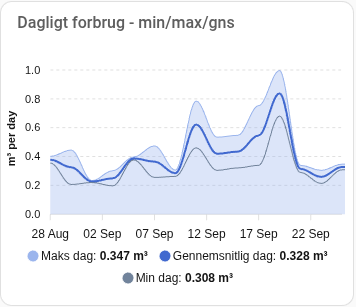

```
type: custom:apexcharts-card
# Set the graph span, i.e. how many days to display:
graph_span: 30d
span:
  start: day
  # Adjust the offset in days in the past (match the span above)
  offset: -30d
header:
  show: true
  title: Dagligt forbrug - min/max/gns
series:
  - entity: sensor.novafos_water_statistics
    name: Maks dag
    type: area
    color: '#9bb5ed'
    opacity: 0.35
    stroke_width: 1
    float_precision: 3
    statistics:
      type: change
      # change your resolution here: day, week, month, year
      # do this for all graphs
      period: day
      align: start
    group_by:
      func: max
      # Change how many units to bundle up at a time: 2d, 2w, 2m, 2y or more
      # do this for all graphs
      duration: 2d
      fill: 'null'
  - entity: sensor.novafos_water_statistics
    name: Gennemsnitlig dag
    type: line
    color: '#4169cf'
    stroke_width: 2
    float_precision: 3
    statistics:
      type: change
      period: day
      align: start
    group_by:
      func: avg
      duration: 2d
      fill: 'null'
  - entity: sensor.novafos_water_statistics
    name: Min dag
    type: line
    color: '#71839b'
    stroke_width: 1
    float_precision: 3
    statistics:
      type: change
      period: day
      align: start
    group_by:
      func: min
      duration: 2d
      fill: 'null'
apex_config:
  chart:
    height: 250
  yaxis:
    min: 0
    title:
      text: m³ per day
```

### Monthly max/min/mean consumption

This configuration illustrates daily min/max/mean values across a year using a 2-monthly grouping.

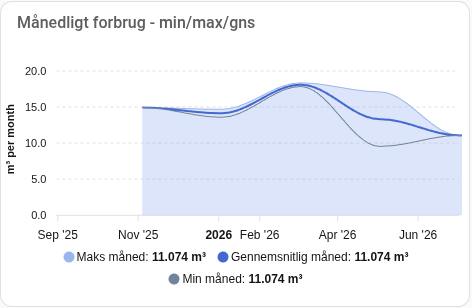

```
type: custom:apexcharts-card
graph_span: 365d
span:
  end: month
  offset: -1month
header:
  show: true
  title: Månedligt forbrug - min/max/gns
series:
  - entity: sensor.novafos_water_statistics
    name: Maks måned
    type: area
    color: '#9bb5ed'
    opacity: 0.35
    stroke_width: 1
    float_precision: 3
    statistics:
      type: change
      period: month
      align: start
    group_by:
      func: max
      duration: 60d
      fill: 'null'
  - entity: sensor.novafos_water_statistics
    name: Gennemsnitlig måned
    type: line
    color: '#4169cf'
    stroke_width: 2
    float_precision: 3
    statistics:
      type: change
      period: month
      align: start
    group_by:
      func: avg
      duration: 60d
      fill: 'null'
  - entity: sensor.novafos_water_statistics
    name: Min måned
    type: line
    color: '#71839b'
    stroke_width: 1
    float_precision: 3
    statistics:
      type: change
      period: month
      align: start
    group_by:
      func: min
      duration: 60d
      fill: 'null'
apex_config:
  chart:
    height: 250
  yaxis:
    min: 0
    title:
      text: m³ per month
```

## Hourly consumption in the built-in Statistics graph

Enable external statistics in the integration settings. This publishes
`novafos:water_hourly_consumption` and, if available, `novafos:heating_hourly_consumption`.
These are external statistic IDs, not sensor entities, so they are not shown on the Entities page.
To find them in the dashboard editor, choose **Add card**, **By card**, **Statistics Graph**,
then **Add a statistic**. Search for **Novafos water hourly consumption** (or heating).
The picker lists external statistics that have data. The equivalent YAML configuration is:

```yaml
type: statistics-graph
entities:
  - novafos:water_hourly_consumption
period: day
days_to_show: 30
stat_types:
  - change
chart_type: line
```

Each point is the **total consumption** for that day. Change `period` to `week`, `month`
or `year` to compare consecutive calendar periods with the same statistic ID; increase
`days_to_show` to include enough periods. `sum` is the running total, not the consumption
within each period. `min`, `mean` and `max` summarize the **hourly** readings within each
period, not its total consumption. The current, unfinished period can appear in the graph.
For a single number use a Statistic card with `entity: novafos:water_hourly_consumption`,
`stat_type: change`, and a calendar or rolling period.

# Visualisation of the sensors using apex-chart

So you might say, "but I like Apex-chart better, can I use that?!".  Certainly.  Apex-chart has evolved to also being able to
show statistic sensors.  Not the "external statistic" type though, which for some reason are named "domain:sensor_name" instead of "sensor.sensor_name".

Here are some apex-chart examples.  With these example you should get the idea and work from there.

## Chart showing daily change

Use `change` for consumption in each day. `sum` and `state` are also available.

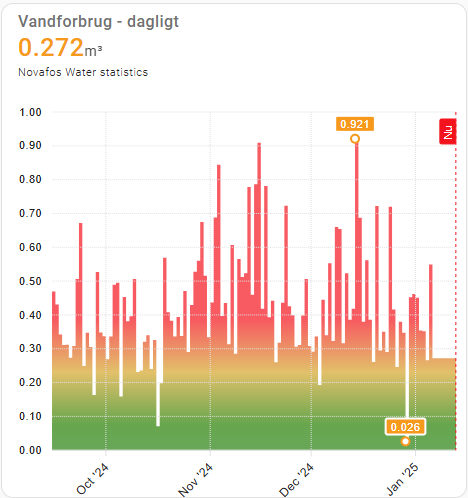

```
type: custom:apexcharts-card
graph_span: 120d
span:
  end: day
now:
  show: true
  label: Nu
  color: red
header:
  show: true
  title: Vandforbrug - dagligt
  show_states: true
  colorize_states: true
experimental:
  color_threshold: true
all_series_config:
  show:
    legend_value: false
    datalabels: false
    extremas: true
    in_brush: true
  float_precision: 3
  type: area
  fill_raw: last
  color_threshold:
    - value: -1
      color: "#1E90FF"
    - value: 0.1
      color: "#008000"
    - value: 0.25
      color: "#DAA520"
    - value: 0.4
      color: "#FF0000"
series:
  - entity: sensor.novafos_water_statistics
    statistics:
      type: change
      period: day
      align: start
apex_config:
  chart:
    height: 400px
    animations:
      enabled: false
      easing: easeinout
      speed: 800
      animateGradually:
        enabled: true
        delay: 150
    zoom:
      enabled: true
      type: x
      autoScaleYaxis: true
      zoomedArea:
        fill:
          color: "#90CAF9"
          opacity: 0.4
        stroke:
          color: "#0D47A1"
          opacity: 0.4
          width: 1
  yaxis:
    decimalsInFloat: 2
    labels:
      show: true
    tooltip:
      enabled: true
    crosshairs:
      show: true
  xaxis:
    labels:
      show: true
      rotate: -45
      rotateAlways: true
  stroke:
    show: false
    curve: stepline
  markers:
    size: 0
  grid:
    show: true
    strokeDashArray: 1
    position: front
    xaxis:
      lines:
        show: true

```

## Weekly chart

This one is considerably less fancy, and shows the weekly aggregation of the hourly dataset.

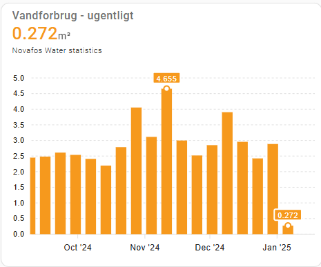

```
type: custom:apexcharts-card
graph_span: 120d
span:
  end: day
header:
  show: true
  title: Vandforbrug - ugentligt
  show_states: true
  colorize_states: true
all_series_config:
  show:
    legend_value: false
    datalabels: false
    extremas: true
    in_brush: true
  float_precision: 3
  type: column
  invert: false
series:
  - entity: sensor.novafos_water_statistics
    statistics:
      type: change
      period: week
      align: start
```

## Daily consumption and 7-day mean

This chart shows daily consumption as columns and the mean daily consumption in each 7-day block as a line.
Both series use the main hourly sensor's historical `change` values, not its unknown current state or the removed `mean` statistic.

```yaml
type: custom:apexcharts-card
graph_span: 28d
span:
  start: day
  offset: -28d
header:
  show: true
  title: Daily water use
series:
  - entity: sensor.novafos_water_statistics
    name: Daily
    type: column
    unit: m³/day
    float_precision: 3
    statistics:
      type: change
      period: day
  - entity: sensor.novafos_water_statistics
    name: 7-day mean
    type: line
    unit: m³/day
    float_precision: 3
    statistics:
      type: change
      period: day
    group_by:
      func: avg
      duration: 7d
      fill: "null"
```

## Lowest, mean and highest day

This card compares daily consumption within each 7-day block. The header shows the latest block's lowest, mean and highest
day; the chart shows four consecutive blocks. These are **daily totals**, not the smallest and largest hourly readings.

```yaml
type: custom:apexcharts-card
graph_span: 28d
span:
  start: day
  offset: -28d
header:
  show: true
  show_states: true
  title: Weekly water use per day
series:
  - entity: sensor.novafos_water_statistics
    name: Lowest day
    float_precision: 3
    statistics:
      type: change
      period: day
    group_by:
      func: min
      duration: 7d
      fill: "null"
  - entity: sensor.novafos_water_statistics
    name: Mean day
    float_precision: 3
    statistics:
      type: change
      period: day
    group_by:
      func: avg
      duration: 7d
      fill: "null"
  - entity: sensor.novafos_water_statistics
    name: Highest day
    float_precision: 3
    statistics:
      type: change
      period: day
    group_by:
      func: max
      duration: 7d
      fill: "null"
```

The 28-day window ends at the start of today, excluding today's incomplete data. Novafos may be several days behind:
if the last 7-day block has missing days, shift `span.offset` further back until it contains seven reported days.
These are consecutive 7-day blocks, not calendar weeks. For heating, replace `water` with `heating` in the entity ID;
in the first chart, also change each `unit: m³/day` to `unit: kWh/day`. The second chart uses the sensor's unit automatically.

# Debugging

It is possible to debug log the raw response from KMD API. This is done by setting up logging
like below in configuration.yaml in Home Assistant. It is also possible to set the log level
through a service call in UI. Be aware that a lot of information is dumped to the log, so
only have this activated when reporting a bug.  However, _when_ reporting a bug, please have
this information saved to send.  It really helps a lot.

```
logger:
  default: info
  logs:
    custom_components.novafos: debug
```
